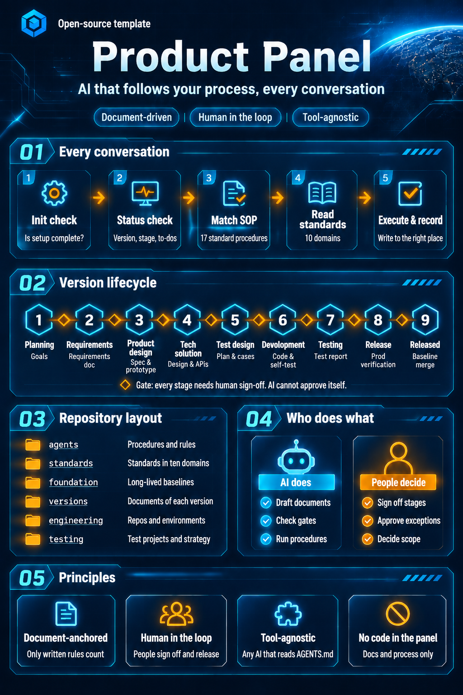

# Product Panel

[简体中文](./README.md) | **English**

> A spec-driven development (SDD) scaffold for AI coding agents: documents first, code second. It puts the process and document structure for requirements, design, technical solution, testing and release into one git repository, so the AI can rebuild context in every new conversation and follow the process with a human in charge.

<p align="center"></p>

> **Language note:** the rules, SOPs, standards and document templates in this repository are written in Chinese. This page is an English introduction; the Chinese [README](./README.md) is the primary one.

---

## What it solves

When you build a product with an AI agent, the hard part is rarely "it cannot write it". It is usually one of these:

| Problem | What the panel does |
|---------|---------------------|
| Every new conversation, the AI has forgotten where the project stands | State lives in fixed files. The AI reads them first and reports the current version, stage and open items |
| The AI skips steps: a solution before requirements are confirmed, code before test cases exist | A version moves through 9 stages. Before each move the AI checks the preconditions one by one and refuses if any is missing |
| The AI declares "done" or "tests passed" on its own | A stage is complete only when a person signs it off. Only a person can waive a test case, one at a time. AI self-review does not count |
| Documents drift apart when requirements change | Every change is logged first, with the list of affected documents, then applied |
| Documents are scattered and nobody knows which is current | Each kind of document has one location. A version holds only its own changes, which are merged into the baseline at release |
| Rules exist only in one chat or one AI's memory | Only rules written in the repository count, so they survive a change of tool or person |

## Who it is for

- Individuals or small teams building products with Claude Code, Cursor, Windsurf, Codex or similar agents
- People who want the AI involved from requirements to release, not only in coding
- New products starting from zero, or existing products that need a lasting document and process structure

It is a poor fit for one-off tasks where the AI changes a few lines, or for teams that already run a mature delivery platform and do not want to be document-driven.

## Get started in three steps

**1. Get the template**

On GitHub, click **Use this template** → **Create a new repository** to get a repository of your own without this template's commit history, then clone it.

Or clone directly:

```bash
git clone https://github.com/zt994451054/product_panel.git my-product
```

**2. Open the directory in your AI coding tool**

**3. Say one sentence to the AI**

For a new product:

```
我刚 clone 了这个面板，打算做一个全新产品，帮我开始初始化。
```

For an existing product:

```
我们有一个已上线的产品，想把它迁移到这个面板统一管理，帮我开始。
```

(The first means "I just cloned this panel and want to build a new product, help me initialize it". The second means "We have a product in production and want to manage it with this panel, help me start". You can say it in your own language.)

The AI then walks you through the checklist in [SETUP.md](./SETUP.md). To begin you answer two things: what the product is and what problem it solves, and who owns product, engineering and testing. Everything else can wait until the stage that needs it. For each item you can answer in conversation, let the AI explore your code and documents read-only and write a draft for you to review, or skip it for now.

Not sure what to say next? See [Prompts for common situations](#prompts-for-common-situations) below for the full steps for new and existing products and the prompts each role uses.

This is a scaffold. Once initialized it is your repository, and you are free to change the process, standards and layout.

## How it works

### Every conversation

The AI's entry point is [AGENTS.md](./AGENTS.md). Each new conversation follows a fixed order:

1. **Init check**: run the status command and finish the required items first
2. **Status check**: read the current version, stage and recent changes, then summarize. A stage stalled for more than 14 days is flagged
3. **Match SOP**: find the standard operating procedure for the task
4. **Read standards**: read the relevant files in `standards/` before producing anything
5. **Execute and record**: follow the SOP and write documents to their defined locations

### Version lifecycle

```
Planning → Requirements → Product design → Tech solution → Test design → Development → Testing → Release → Released
```

Some deliberate choices:

- **Test design comes before development.** The test plan and cases exist first, and developers self-test against them
- **Core implementation paths are verified before development.** Key technical assumptions are tested early, not discovered broken at acceptance
- **All tests must pass.** There is no "conditional pass". Only a person can waive a case
- **The frontend follows the prototype.** The unified prototype is the reference, and deviations are logged as defects
- **Release includes business verification in production**, not only a health check
- **Closing a version has a checklist**: merge and tag, merge changes into the baseline, clean up temporary resources

### 17 standard procedures

| Area | Procedures |
|------|-----------|
| Getting started | New product setup, onboarding an existing product, read-only exploration |
| Requirements and design | Backlog, requirements and product design, change handling |
| Engineering and testing | Technical solution, test design and execution, development and bug fixing |
| Versions and release | New version, stage gate, production acceptance |
| Production and operations | Production bug triage, hotfix, operations and infrastructure change |
| General | Preparation before any task, object storage upload |

The full index is in [AGENTS.md](./AGENTS.md) §5 and the procedures are in [agents/sop/](./agents/sop/).

## Directory guide

| Path | Purpose |
|------|---------|
| `AGENTS.md` | The AI's entry point, read in every conversation |
| `SETUP.md` | Configuration checklist: the items plus instructions per item |
| `agents/` | Procedures (SOPs), collaboration and communication rules |
| `state/` | Project state: append-only event records, read and written by the tool. Do not edit by hand |
| `tools/` | State tool: `node tools/panel.mjs render` builds a read-only cockpit page (`cockpit.html`), `status` prints the same as text; the AI uses it to record stages and sign-offs |
| `standards/` | 59 default standards in 10 domains, usable as-is or editable. See [standards/README.md](./standards/README.md) |
| `foundation/` | Long-lived baselines across versions: market, business model, product architecture, technical architecture, unified prototype |
| `versions/` | Per-version requirements, design, solution, testing and release documents. Run `node tools/panel.mjs status` to see where each version stands |
| `engineering/` | Index of engineering repositories and environment docs. Code is cloned into `workspace/` and never committed here |
| `testing/` | Index of test projects and the test strategy |
| `materials/` | Source material you give the AI (files stay out of git, only a list is kept) |
| `maintainer/` | The template's own validation suite. Not needed for daily use and safe to delete |

## Principles

- **Document-anchored**: rules and state live in repository files, not in an AI's memory
- **Human in the loop**: the AI drafts, checks and executes. Sign-off, waivers and scope changes belong to people
- **Tool-agnostic**: the rules are Markdown, so any tool that reads `AGENTS.md` works. `CLAUDE.md`, `.cursorrules` and `.windsurfrules` only point to it
- **No code in the panel**: the panel holds documents and process, and code stays in its own repositories
- **Record changes first**: log the change and its impact, then edit documents
- **Write the delta, read the baseline**: a version holds only its own changes, merged into the baseline at release

## Optional modules

Off by default and enabled when needed: internationalization (i18n), product planning (roadmap and direction), smoke testing. See "可选模块" in [SETUP.md](./SETUP.md).

## Prompts for common situations

Not sure how to ask? There are three ways in: **new to the panel**, **step by step by project type** (new product / existing product), and **by your role**. Find your situation and copy the prompt to the AI, replacing the text in square brackets. You do not need to know procedure names, the AI finds the right one. You can write in any language and the AI answers in the language you use.

### Getting started

<details open>
<summary><b>First contact, no idea how to use it</b> (11)</summary>

**You know nothing about the panel**

```
This is my first time with this panel. Tell me in plain words what it is, what it can do for me and what I need to do.
```

**You do not know what you can ask for**

```
I am a [product manager / designer / engineer / tester / operator]. What can I ask you to do in this panel? Give me one sentence I can say for each.
```

**You just joined and do not know where to start**

```
I am a [role] and just joined this project. Tell me where the project stands and where I should start.
```

**The directories and files make no sense to you**

```
Give me a tour of this repository: what each directory is for and which ones my role uses day to day.
```

**You do not know what to do next**

```
What should I do next?
```

**You do not understand a term the AI used**

```
What does [gate / baseline / sign-off / change record] mean? Explain in one sentence and give an example.
```

**You want to do something and are not sure it is allowed now**

```
I want to [do something]. Is that possible at this stage? If not, what is missing?
```

**The AI says it cannot move forward**

```
Why can't we move forward? List what is missing item by item, and for each tell me who fills it in and how.
```

**The AI asks too many questions at once**

```
Too many questions. Ask only the few that block us now, give default suggestions for the rest, and I will accept them.
```

**You said something wrong and want to correct it**

```
My earlier decision was wrong. It should be [correct content]. Fix it and tell me what it affects.
```

**You want to try it on something small first**

```
I want to try it out first: take one very small feature through the whole process, guide me, and tell me why at each step.
```

</details>

<details>
<summary><b>New product: from kickoff to the first release</b> (14)</summary>

Follow the order. After each step the AI tells you the next one. Whenever unsure, ask "What should I do next?"

**Step 1: Start initialization**

```
I just cloned this panel and want to build a new product. Help me initialize it.
```

**Step 2: State the product and the owners (required, a few minutes)**

```
The product is called [name]. It solves [problem] for [who]. Product owner [name], engineering owner [name], testing owner [name]. The first version is v1.0.0.
```

**Step 3: Decide on standards: keep the defaults or import your own**

```
Keep the default standards for now. (If your team has its own: our standards are at [location]. Import them and tell me how they differ from the defaults.)
```

**Step 4: Market and business material: write it now or skip**

```
Skip market research, competitors and business model for now. (If you have material: I have market and competitor material at [location]. Draft from it.)
```

**Step 5: Put ideas into the backlog and scope the first version**

```
For the first version I want these: [list]. Put them in the backlog, then let's decide which go into v1.0.0.
```

**Step 6: Write the requirements**

```
These requirements are confirmed for v1.0.0. Expand each into a detailed requirements document and ask me about anything unclear first.
```

**Step 7: After confirming requirements, prepare for product design**

```
I have confirmed the requirements. Check whether we can enter product design, and guide me through anything that must be prepared first, such as the design standard.
```

**Step 8: Write the product design and build the prototype**

```
Write the product design document for v1.0.0 and build its pages into the unified prototype.
```

**Step 9: Choose the stack, register repositories, write the technical solution**

```
We plan to use [stack]. The repositories are [URLs, or not created yet]. Register them, draft the architecture, then write the technical solution for v1.0.0.
```

**Step 10: Write the test plan and cases (before development)**

```
I have confirmed the technical solution. Write the test plan and test cases for v1.0.0.
```

**Step 11: Develop**

```
I have confirmed the test cases, so development can start. First document the local development environment, then develop [first feature].
```

**Step 12: Test**

```
v1.0.0 is deployed to the test environment. What environment and deployment information is still missing before testing? Help me fill it in, then start executing the cases.
```

**Step 13: Release, accept, close**

```
v1.0.0 passed testing. Prepare the release. After going live, take me through production verification and acceptance, then finish the closing checklist.
```

**Step 14: Start the next version**

```
v1.0.0 is released. Start preparing v1.1.0.
```

</details>

<details>
<summary><b>Existing product: onboarding</b> (13)</summary>

Follow the order. After each step the AI tells you the next one. Whenever unsure, ask "What should I do next?"

**Step 1: Start onboarding**

```
We have a product in production and want to manage it with this panel. Help me start.
```

**Step 2: State the product and owners, pick a version number**

```
The product is called [name]. It solves [problem] for [who]. Owners are [product / engineering / testing]. It has been live for [how long], with [number] major iterations, and there [is / is not] an iteration in progress. Suggest a suitable version number.
```

**Step 3: Give pointers: code, documents, production URL**

```
The code is at [path or repository URL], existing documents are at [location], and production is at [URL]. Explore read-only and change nothing.
```

**Step 4: Have the AI draft the current state**

```
From these pointers, document the current state: feature list, architecture, schema, API list, local development setup, environment configuration and deployment. Write drafts for me to review and mark anything you are unsure about.
```

**Step 5: For products with a UI: derive the design standard**

```
Our UI is at [code path / screenshots / URL]. Derive a draft design standard from it.
```

**Step 6: Review the drafts**

```
List the summary of the drafts, the contradictions you found and the questions I need to answer. I will review in batches.
```

**Step 7: Confirm or send back an item**

```
I have reviewed [item] and it is fine. Confirm it. (If not: [item] is wrong here: [description]. Fix it and show me again.)
```

**Step 8: Bring in your team's existing standards**

```
Our team already has [coding / commit / testing / release] standards at [location]. Import them and list the conflicts with the defaults for me to decide.
```

**Step 9: Migrate the requirements of the current iteration**

```
The requirements of our current iteration are at [document or file location]. Migrate them in. Leave the originals untouched and do not bring in past versions.
```

**Step 10: Record known production issues**

```
There are some known production issues: [list]. Record them and I will decide how to handle each.
```

**Step 11: An item does not apply or you do not want to fill it now**

```
[Item] does not apply to us (or I do not want to fill it now). Mark it and tell me when I will be asked to complete it.
```

**Step 12: Too much for one session**

```
Let's stop here for today. What is still not onboarded, and where do we continue next time?
```

**Step 13: Confirm that daily work can start**

```
Is onboarding complete? Can I start writing new requirements now? When will the remaining gaps block me?
```

</details>

### Day to day, by role

<details>
<summary><b>Product managers</b> (16)</summary>

**A new idea, not yet decided**

```
I have a new idea. Put it in the backlog: [description]. Do not assign it to any version yet.
```

**You did research and do not know where to put it**

```
I did some research on [requirement]. The material is at [location]. Turn it into a research note and link it from the backlog item.
```

**A requirement is confirmed**

```
[Requirement] is confirmed for [version]. Expand it into a full requirements document.
```

**You need a PRD for a feature**

```
Write the requirements document (PRD) for [feature]: background, target users, user stories, business rules, acceptance criteria. Ask me about anything unclear first.
```

**Business rules and edge cases are incomplete**

```
Go through the business rules and edge cases of [feature], list the ones I have not considered, and show me before writing them into the requirements.
```

**You are not sure the requirements are complete**

```
Review the requirements of [version]: which features are still drafts, what questions and unverified assumptions remain, and what is missing before product design.
```

**Requirements are done and you want to move on**

```
I have confirmed all requirements of [version]. Check whether we can enter product design and show me the summary.
```

**A requirement must change midway**

```
The [feature] requirement in [version] needs to change: [description]. First tell me which documents are affected and whether scope grows, then make the change.
```

**You are short on time and want to cut or defer**

```
[Version] is running late. I want to move [feature] to the next version. Assess the impact and handle it.
```

**You forgot how something was decided**

```
How was [topic] decided earlier? Look up the decision and change records and quote what was said.
```

**Acceptance after going live**

```
[Version] is deployed to production. Generate the acceptance cases, and start once I confirm the scope.
```

**The version is released, plan the next one**

```
[Version] is released. Go through the backlog for candidates and start preparing the next version.
```

**The backlog has piled up and needs review**

```
Walk me through the backlog: which items are waiting for review, so I can decide for each to do it, drop it or defer it.
```

**This version changes the product's module structure**

```
[Version] adds or changes [module]. Show me how the product architecture and feature list should be updated.
```

**You want to know the standard for writing requirements**

```
What standard do requirements and acceptance criteria follow in this project? List the key points.
```

**Your team writes requirements differently**

```
Our team writes requirements like this: [description]. It differs from the panel. Update the requirements standard and the document template.
```

</details>

<details>
<summary><b>Designers</b> (13)</summary>

**No design standard yet**

```
Help me set up the design standard. My references are [brand colors / reference product / location of existing designs].
```

**You have existing screens and want a standard derived from them**

```
Our existing UI is at [code path / screenshots / URL]. Explore it read-only and draft a design standard for me to review.
```

**Requirements are confirmed, time to write the design**

```
The requirements of [version] are confirmed. Write the product design document, focusing on user flows, error branches and states.
```

**New pages need to go into the prototype**

```
Add the new [page] of [version] to the unified prototype for [web / mobile / desktop].
```

**The product needs a new device type**

```
We are adding a [mini program / desktop] client. Add its entry and home page to the unified prototype.
```

**The prototype is settled but one thing must change**

```
The [page] prototype in [version] needs a change: [description]. Handle it as a change.
```

**You need to decide which pages require strict fidelity**

```
List every page involved in [version] so I can set the fidelity level of each.
```

**Design and prototype are confirmed**

```
I have confirmed the design and prototype of [version]. Pin the prototype baseline and check whether we can enter the technical solution stage.
```

**You want to check the build against the prototype**

```
Compare the implementation of [page] with the prototype item by item and list every difference.
```

**You need to put design screenshots in a document**

```
I need to reference some design screenshots in the design document. The files are at [location]. Upload them and put the links in the document.
```

**The design standard needs a change**

```
The design standard needs a change: [primary color / font size / spacing / component] becomes [new value]. Update it and tell me which existing pages are affected.
```

**You want to see or change the interaction rules**

```
What interaction rules apply to [web / mobile / desktop]? I want to change [one of them]: [description].
```

**A new interaction pattern not covered by the standard**

```
For [page] I want a new interaction pattern: [description]. Can existing components cover it? If not, add it to the standard.
```

</details>

<details>
<summary><b>Engineers</b> (18)</summary>

**You need to tell the AI where the code is**

```
Our repositories are: [URLs and purposes]. Register them in the engineering index.
```

**An existing codebase the AI should learn**

```
The code is at [path]. Explore it read-only and draft the architecture, schema and API list for me to review.
```

**You need the local environment documented**

```
Document how to set up and start the local development environment. The project is at [path].
```

**Time to write the technical solution**

```
Write the technical solution for [version], including API design and database design.
```

**You are not sure an approach will work**

```
I am not sure [key implementation] in [version] is feasible. Build a minimal test and record the result and evidence in the technical solution.
```

**You need a new technology or middleware**

```
[Version] needs [technology / middleware]. Update the solution and dependency records and tell me about license and operations risks.
```

**The solution is done and you want to move on**

```
I have reviewed the technical solution of [version] and it is fine. Check whether we can move on and show me the core path verification results.
```

**You want to know the standards before coding**

```
I am about to write [language / framework / middleware] code. Which project standards apply? List the key points.
```

**Time to build a feature**

```
Develop [feature] of [version].
```

**An API or table must change during development**

```
[API / table] needs to change: [description]. Handle it as a change and tell me which documents and test cases are affected.
```

**Time to fix a bug**

```
Fix [defect id]. First check whether the same problem exists elsewhere and whether there is an existing way to handle it.
```

**Team habits differ from the panel's standards**

```
Our team's convention for [commit messages / branches / naming] is [description], which differs from the panel. Update the standard.
```

**Stopping midway, or resuming the next day**

```
Let's stop here for today. Leave a hand-off note. (To resume, say: continue from where we left off.)
```

**The project has no standard for something and you want one**

```
The project has no standard for [topic]. Add one based on how we do it: [description].
```

**The feature is written and needs self-testing**

```
[Feature] is done. Self-test it against the test cases and compare the frontend pages with the prototype one by one.
```

**Time to commit**

```
The code is done. Commit and push it following the project's branch and commit conventions.
```

**You want a code review**

```
Review the code in [branch or commit] against the project standards and list the issues by severity.
```

**A technology decision needs to be recorded**

```
We decided on [technology choice] because [reason], and rejected [alternative]. Record it as an architecture decision.
```

</details>

<details>
<summary><b>Testers</b> (16)</summary>

**Time to write the test plan and cases**

```
[Version] has entered test design. Write the test plan and test cases.
```

**You worry the cases miss something**

```
Review the test cases of [version] from an independent angle: any missing feature points or error branches, any vague expected results.
```

**You do not know what to prepare before testing**

```
What environments, devices, accounts and data does [version] need before testing? Which of them do I have to provide?
```

**The build is ready for testing**

```
[Version] is deployed to the test environment. Check the entry conditions and the build under test, then start executing the cases.
```

**You tested by hand and need to report the result**

```
I tested [case id or feature] by hand and the result is [description]. Record it.
```

**You found a bug**

```
Testing found a [P0 / P1 / P2] bug: [symptom and steps to reproduce]. Record it.
```

**You are not sure if it is a test bug or a production bug**

```
I found a problem: [description]. I am not sure if it is a test bug or a production bug. Tell me where it should be recorded.
```

**The developer says the bug is fixed**

```
The developer says [defect id] is fixed. Re-run the linked test cases.
```

**One item cannot be fixed and you decide to waive it**

```
I decide to waive [case or defect id] for this version. Scope: [client or scenario]. Reason: [reason]. To be fixed by [version] at the latest. Record it.
```

**You want to know test progress**

```
How is testing of [version] going? Which cases are not run, failed or blocked?
```

**Requirements changed during testing**

```
During testing, [feature] needs to change: [description]. Handle the change and tell me which cases must be re-run.
```

**Testing is done and you need the report**

```
Testing of [version] is finished. Write the test report.
```

**You want a test strategy**

```
Draft the test strategy for this product: what is covered by unit tests, what by API tests, and what must be tested end to end.
```

**You are not sure what to regression-test**

```
Which existing features are affected by the changes in [version]? Define the regression scope and list anything you would cut for me to confirm.
```

**A feature has performance requirements**

```
[Feature] has a performance requirement of [metric]. Add the performance test targets and cases.
```

**Your team's case format or severity levels differ**

```
Our team's convention for [test case format / defect severity] is [description]. Update the testing standard.
```

</details>

<details>
<summary><b>Operations and release</b> (14)</summary>

**The AI needs to learn how you deploy**

```
We deploy by [description]. Scripts and pipelines are at [location]. Explore read-only and draft our operations and release profile for me to review.
```

**You need the differences between test and production written down**

```
Document the configuration of the test and production environments and where they differ.
```

**Tests passed, time to prepare the release**

```
[Version] passed testing. Move it to the release stage and prepare the release steps and rollback plan.
```

**You are not sure this release needs a rehearsal**

```
Which schema changes or irreversible operations does this release of [version] include? Do we need to rehearse the release and rollback first?
```

**It is deployed to production**

```
[Version] is deployed to production. Verify the running version and go through the production business checks one by one.
```

**Acceptance passed, time to close the version**

```
I have signed off the acceptance of [version]. Finish the closing checklist and mark it released.
```

**An urgent production problem**

```
Production has a problem: [symptom and impact]. It is urgent. First show me how to stop the bleeding, then plan the fix.
```

**A non-urgent production bug**

```
We found a bug in production: [description]. It is not urgent. Record it for now.
```

**You want to change deployment, middleware or config source**

```
We want to change [deployment method / middleware version / config source] to [new approach]. Assess the impact and plan it.
```

**Something went live before the process was finished**

```
[Version or change] already went live because of [reason], before the process was finished. Record it and tell me what still has to be done.
```

**You need screenshots, recordings or logs in documents**

```
I need to reference screenshots and recordings in documents. Set up object storage, upload them, and keep only links in the documents.
```

**Your release or rollback practice differs**

```
Our [release window / pipeline / rollback method] is [description]. Update the deployment standard and the release document template.
```

**You want to check monitoring and alerting**

```
Check the monitoring and alerting of [service] against the standard and tell me what is missing.
```

**An incident is resolved and needs a review**

```
[Incident] is resolved. Write the post-incident review and propose which lessons should become rules.
```

</details>

<details>
<summary><b>Leads and managers</b> (11)</summary>

**You want the overall picture**

```
Show me the current project status: where each version stands and what is stuck.
```

**You are not sure what is waiting on you**

```
What is waiting for my decision or sign-off right now? List each item and what it blocks.
```

**A stage has been stuck for a long time**

```
[Stage] has been stuck for a while. Show me what is blocking it, what must be done now and what could move later.
```

**You want to start another version in parallel**

```
The mainline version is not released yet. I want to start [version] in parallel for [content]. Set it up.
```

**You want to pause or drop a version**

```
Pause [version] because [reason], to resume when [condition]. Record it.
```

**You will be away and want the AI to continue alone**

```
I will be away for [time]. Continue on [scope] by yourself. Before you start, list everything you need me to decide in advance.
```

**You are taking over the project**

```
I am taking over this project. Bring me up to speed on the current state, recent changes and what comes next.
```

**The process does not fit and you want to change a rule**

```
I want to change a panel rule: [description]. Make the change, log it, and tell me how it affects versions in progress.
```

**The product needs i18n, roadmap planning or smoke tests**

```
Our product needs [multiple languages / roadmap planning / smoke tests]. Enable the matching module.
```

**You do not know where something belongs**

```
I am not sure which file [content] belongs in. Tell me where it goes.
```

**An owner has changed**

```
The [product / engineering / testing] owner is now [name]. Update it.
```

</details>

## FAQ

**How is this different from just asking an AI to write code?**
When you just ask, the result depends on what you happened to say in that conversation. The panel keeps "where the project stands, what the rules are, what comes next" in files the AI reads first, so the behavior stays the same across conversations, people and tools.

**Do I have to fill in every configuration item before starting?**
No. Only two items are required (product basics, version and owners), which takes a few minutes. The rest can wait until the stage that needs them, and each can be answered in conversation, drafted by the AI after exploring, or skipped for now.

**Our existing product has messy docs, or none. Can we still onboard?**
Yes. Give the AI pointers (code paths, existing documents, production entry points). It explores read-only and writes the current state as a draft marked "pending review", with its evidence and open questions. Nothing takes effect until you confirm it, and the AI cannot confirm for you.

**Is it worth it for a solo builder?**
Yes. Working alone, the usual failures are skipped steps and lost context, which is exactly what the panel guards against. You can be the product, engineering and testing owner at once.

**The process feels heavy. Does a small change really go through nine stages?**
Every version goes through the same stages, but anything that does not apply can simply be marked "none". Urgent production bugs have a separate hotfix flow that skips requirements and product design. If it still feels heavy, the repository is yours after initialization: ask the AI to change the rules in `AGENTS.md` and `agents/`, and log the change in `agents/rules-log.md`.

**Where does the code go?**
In its own repositories. Register them in `engineering/README.md` and the AI clones them into `engineering/workspace/`, which git ignores. The only code in the panel is the unified prototype.

**Which AI tools are supported?**
Any tool that reads `AGENTS.md`. Whether the rules actually hold depends on the model, not the tool.

The template's own process drills (taking a version end to end, handling changes, open questions and decision records, release and hotfix) were each run with four models in 2026-11:

| Model tier | What we saw |
|---|---|
| Flagship (Claude Fable 5.2, Claude Opus 5.5, Gemini 4 Hydrogen High) | Hold the gate and sign-off rules, record what they cannot verify as not passed, and write "to be filled in" where nobody supplied a source. Occasionally treat one sentence as confirmation of two things; the commands catch part of this |
| Lightweight (Gemini 3.8 Flash High) | Makes up content nobody provided (environment addresses, accounts, defect root causes, review conclusions) and records hearsay as something it verified itself. The commands can check what was filled in, not whether it is true |

We recommend driving the panel with a flagship model. With a lightweight model, check the gate evidence and the quoted words yourself before signing off instead of relying on "gate passed". For other tools, only the entry files pointing to `AGENTS.md` have been checked.

**Can several people each use their own AI?**
Yes, with a caveat: each person can drive their own version on their own branch. State is a set of append-only records, and reading it merges the records from every branch, so nobody overwrites anybody else. Commit and push records promptly so others can see them. Branch and commit discipline is in `agents/collaboration.md`.

## License

[MIT](./LICENSE). Free to use, modify and use commercially, as long as the copyright notice is kept.

## Community

- Thanks to the [LinuxDO](https://linux.do) community for their support
