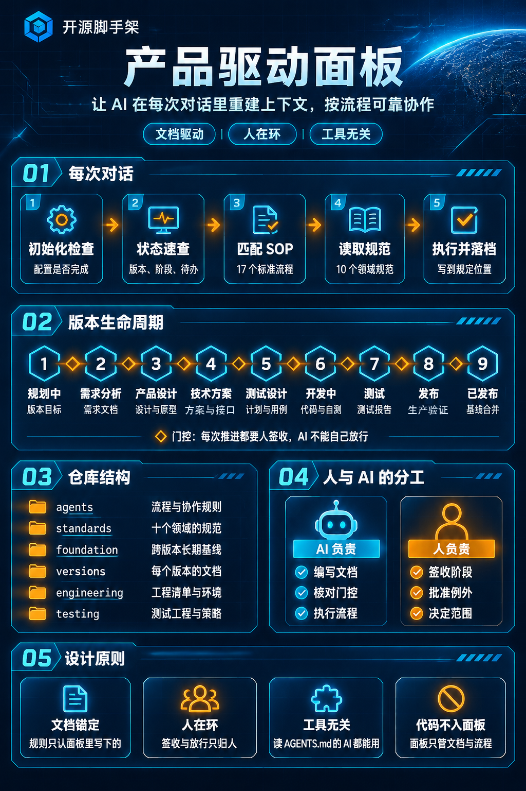

# Product Panel · 产品驱动面板

**简体中文** | [English](./README.en.md)

> 一个给 AI 编码助手用的产品研发脚手架，采用规范驱动开发（SDD，Spec-Driven Development）的做法：先有文档，再写代码。它把需求、设计、技术方案、测试、发布的流程和文档结构放进一个 git 仓库，让 AI 在每次新对话里都能重建上下文，并在人把关的前提下按流程工作。

<p align="center"></p>

---

## 它解决什么问题

用 AI 做产品研发，常见的麻烦不在"写不出来"，而在这几件事：

| 麻烦 | 面板的做法 |
|------|-----------|
| 每次新对话，AI 都不记得项目做到哪了 | 状态写在固定文件里，AI 每次开场先读，一段话汇报当前版本、阶段和待办 |
| AI 跳步：需求没确认就写方案，没有用例就写代码 | 版本分 9 个阶段，每次推进前逐条核对前置条件，不满足就拒绝 |
| AI 自己说"完成了""测试通过了" | 阶段完成必须由人签收；用例豁免只能由人逐条明示；AI 自审不算数 |
| 改需求时文档对不上 | 任何变更先登记再改文档，并列出受影响的文档逐个处理 |
| 文档散落，找不到最新的 | 每类文档有唯一的存放位置；版本里只写增量，发布时合入全量基线 |
| 规则只存在于某次对话或某个 AI 的记忆里 | 规则只认仓库里写下的内容，换工具、换人都生效 |

## 适合谁

- 用 Claude Code、Cursor、Windsurf、Codex 等 AI 编码助手做产品的个人或小团队
- 希望 AI 参与从需求到发布的全过程，而不只是写代码
- 新产品从 0 开始，或已有产品想接入一套可持续的文档与流程

不太适合：只想让 AI 改几行代码的一次性任务，或已有成熟研发管理平台、不打算用文档驱动的团队。

## 三步开始

**1. 取得模板**

在 GitHub 页面点右上角的 **Use this template** → **Create a new repository**，得到一个属于你自己的仓库（不带本模板的提交历史），再 clone 到本地。

也可以直接 clone：

```bash
git clone https://github.com/zt994451054/product_panel.git my-product
```

**2. 用你的 AI 编码工具打开这个目录**

**3. 对 AI 说一句话**

全新产品：

```
我刚 clone 了这个面板，打算做一个全新产品，帮我开始初始化。
```

已有产品：

```
我们有一个已上线的产品，想把它迁移到这个面板统一管理，帮我开始。
```

AI 会按 [SETUP.md](./SETUP.md) 的配置清单引导你。开始只需要回答两件事：产品叫什么、解决什么问题，以及产品、研发、测试负责人是谁。其余配置项到用得上的阶段再补，每一项都可以选择对话填写、让 AI 只读探查你的代码和文档后起草、或暂不填。

这是一个脚手架：初始化之后它就是你自己的仓库，流程、规范、目录都可以按需要修改。

## 它怎么工作

### 每次对话

AI 的入口是 [AGENTS.md](./AGENTS.md)。每次新对话按固定顺序执行：

1. **初始化检查**：读配置状态表，必填项没完成就先引导完成
2. **状态速查**：读当前版本、阶段、最近变更，给出状态摘要；阶段停滞超过 14 天会提醒
3. **匹配流程**：按任务类型找到对应的 SOP（标准流程）
4. **读取规范**：产出前先读 `standards/` 里相关的规范
5. **执行并落档**：按 SOP 执行，文档写到规定位置

### 版本生命周期

```
规划中 → 需求分析 → 产品设计 → 技术方案 → 测试设计 → 开发中 → 测试 → 发布 → 已发布
```

几个值得注意的设计：

- **测试设计在开发之前**：先有测试计划和用例，开发自测和提测都以用例为依据
- **进入开发前要验证核心实现路径**：关键技术假设先实测，不留到验收时才发现走不通
- **测试必须全部通过才放行**：没有"条件通过"，豁免只能由人逐条决定
- **前端按原型还原**：统一原型是基准，偏差记为缺陷
- **发布后要做生产业务验证**：验证真实业务链路，而不只是健康检查
- **已发布时有收尾清单**：合并打标签、增量合入基线、清理临时资源

### 17 个标准流程

| 类别 | 流程 |
|------|------|
| 开始使用 | 新产品初始化、已有产品接入、只读探索与回填 |
| 需求与设计 | 需求池管理、需求与产品设计、变更处理 |
| 研发与测试 | 技术方案、测试设计与执行、开发与缺陷修复 |
| 版本与发布 | 新建版本、阶段推进、生产验收 |
| 线上与运维 | 生产缺陷分级、热修复、运维与基础设施变更 |
| 通用 | 任务前准备、对象存储文件上传 |

完整索引见 [AGENTS.md](./AGENTS.md) §5，流程正文在 [agents/sop/](./agents/sop/)。

## 目录导航

| 目录 | 用途 |
|------|------|
| `AGENTS.md` | AI 的主入口，每次对话必读 |
| `SETUP.md` | 配置清单：状态表 + 每项的填写说明 |
| `agents/` | 流程（SOP）、协作与表达规则 |
| `standards/` | 规范层：10 个领域 59 份默认规范，可直接沿用或修改，导航见 [standards/README.md](./standards/README.md) |
| `foundation/` | 跨版本的长期基线：市场、商业模式、产品架构、技术架构、统一原型 |
| `versions/` | 版本中心：每个版本的需求、设计、方案、测试、发布文档，当前版本见 `versions/CURRENT.md` |
| `engineering/` | 研发工程索引与环境文档；代码 clone 到 `workspace/`，不入本仓库 |
| `testing/` | 测试工程索引与测试策略 |
| `materials/` | 你提供给 AI 的原始资料（文件不入 git，只留清单） |
| `maintainer/` | 模板自身的验证套件，日常使用不需要，可以整目录删除 |

## 快速定位当前工作

```
versions/CURRENT.md        ← 当前版本和阶段
versions/{ver}/README.md   ← 版本进度明细
versions/{ver}/CHANGES.md  ← 最新变更记录
```

## 设计原则

- **文档锚定**：规则和状态都在仓库文件里，不依赖某个 AI 的记忆
- **人在环**：AI 负责起草、核对和执行，签收、豁免、范围变更只归人
- **工具无关**：规则都是 Markdown，任何会读 `AGENTS.md` 的 AI 工具都能用；`CLAUDE.md`、`.cursorrules`、`.windsurfrules` 只是指向它的入口
- **代码不入面板**：面板只管文档与流程，工程代码留在各自仓库
- **变更先记录**：先登记变更和影响范围，再改文档
- **写增量、读基线**：版本内只写本版本的改动，发布时合入全量基线

## 可选模块

默认关闭，用得上时再启用：多语言（i18n）、产品规划（路线图与方向讨论）、冒烟测试。见 [SETUP.md](./SETUP.md)「可选模块」。

## 常见场景提示词

找到你所在的阶段，把提示词复制给 AI，方括号里的内容换成你的实际信息。

<details>
<summary><b>需求管理</b></summary>

有一个新想法，还没决定要不要做：

```
我有一个新需求想法，先帮我记录到需求池：[描述需求]，暂时不纳入任何版本。
```

需求确认要做了：

```
[需求名] 确认要做，纳入 v1.0.0，帮我展开详细需求文档。
```

需求中途要改：

```
v1.0.0 的 [某功能] 需求要改一下：[描述变更内容]。
```

</details>

<details>
<summary><b>产品设计</b></summary>

```
v1.0.0 的需求已经全部确认，帮我写产品设计文档。
```

```
v1.0.0 的产品设计文档写完了，帮我把新增页面更新到统一原型工程里。
```

</details>

<details>
<summary><b>技术方案</b></summary>

```
帮我为 v1.0.0 写技术方案。
```

```
v1.0.0 技术方案里需要引入 [技术/中间件名称]，帮我更新方案和依赖记录。
```

</details>

<details>
<summary><b>测试设计与测试</b></summary>

```
v1.0.0 技术方案我看过了，没问题，帮我写测试计划和测试用例。
```

```
测试发现了一个 [P0/P1/P2] 级 bug：[描述问题]，帮我记录。
```

```
测试过程中，[某功能] 需要调整：[描述变更]，帮我处理这个变更。
```

```
v1.0.0 测试工作已经完成，帮我写测试报告。
```

</details>

<details>
<summary><b>开发</b></summary>

```
帮我开发 v1.0.0 的 [某功能]。
```

```
测试环境发现了一个 bug：[描述问题]，帮我记录一下。
```

</details>

<details>
<summary><b>发布与线上</b></summary>

```
v1.0.0 测试通过，帮我推进到发布阶段。
```

```
v1.0.0 生产环境发现了紧急 bug：[描述问题]，需要立即热修复。
```

```
v1.0.0 线上发现了一个 bug：[描述问题]，不紧急，帮我先记录下来。
```

```
我们要把 [部署方式/配置来源/中间件版本] 改成 [新做法]，帮我评估并安排。
```

</details>

<details>
<summary><b>版本管理与其他</b></summary>

```
v1.0.0 已经正式发布上线了，帮我开始准备 v1.1.0。
```

```
帮我看一下当前项目状态，进展到哪里了。
```

```
我不太确定 [内容描述] 应该记录在哪个文件里，帮我确认一下。
```

</details>

## 常见问题

**必须把所有配置都填完才能开始吗？**
不用。必填的只有两项（产品基本信息、版本与负责人），几分钟就能开始写需求。其余的到对应阶段前再补。

**流程太重了，能精简吗？**
能。初始化之后这就是你的仓库，可以让 AI 帮你修改 `AGENTS.md` 和 `agents/` 里的规则，改动记在 `agents/rules-log.md`。

**代码放在哪里？**
放在各自的工程仓库。在 `engineering/README.md` 登记后，AI 会把代码 clone 到 `engineering/workspace/`（已被 git 忽略）。面板里唯一的代码是统一原型工程。

**支持哪些 AI 工具？**
任何会读 `AGENTS.md` 的工具都可以。模板的流程演练目前只在 Claude Code 上做过，其他工具只验证了入口文件能指向 `AGENTS.md`。

## 许可

[MIT](./LICENSE)。可以自由使用、修改和商用，保留版权声明即可。

## Community

- Thanks to the [LinuxDO](https://linux.do) community for their support
