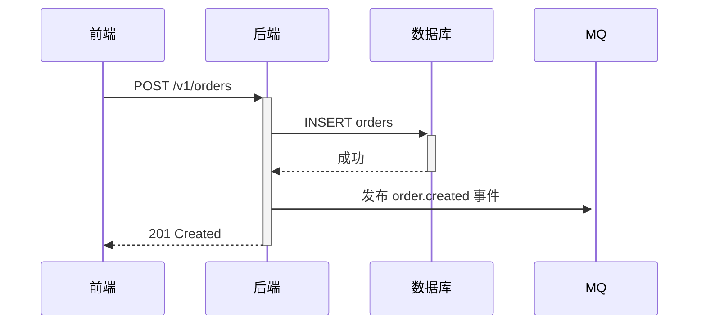

# 技术文档撰写规范

> **主标准**：[Diátaxis Framework](https://diataxis.fr/)（文档类型与结构）
> **副标准1**：[Google Developer Documentation Style Guide](https://developers.google.com/style)（写作风格）
> **副标准2**：[Microsoft Writing Style Guide](https://learn.microsoft.com/style-guide)（术语和语气）

---

## 文档类型框架（Diátaxis）

Diátaxis 将技术文档分为四种类型，每种类型有明确的目的和写法。混淆类型是技术文档质量差的主要原因。

Diátaxis 的两条轴：**行动 / 认知**（读者是要动手做，还是要理解）× **学习 / 工作**（读者是在学习阶段，还是在工作中查用）。

| | 学习（Study） | 工作（Work） |
|---|---|---|
| **行动（Action）** | 教程（Tutorial） | 操作指南（How-to Guide） |
| **认知（Cognition）** | 解释（Explanation） | 参考（Reference） |

| 类型 | 目的 | 回答的问题 | 示例 |
|------|------|-----------|------|
| **教程（Tutorial）** | 带领读者完成一次学习体验 | "我如何开始？" | 快速入门指南、Hello World |
| **操作指南（How-to）** | 指导读者完成具体任务 | "我如何实现 X？" | 如何配置 Redis、如何部署服务 |
| **参考（Reference）** | 提供精确的技术描述 | "X 是什么？参数有哪些？" | API 文档、配置项说明 |
| **解释（Explanation）** | 帮助读者理解概念和背景 | "为什么这样设计？" | 架构决策记录、设计原则说明 |

【必须】在撰写文档前，先确定文档类型，不同类型有不同写法：
- 教程：以用户体验为中心，一步步带着做
- 操作指南：直接给操作步骤，假设读者知道自己要做什么
- 参考：完整、准确、简洁，像字典一样
- 解释：可以展开讨论，解释背景和取舍

---

## 写作风格（Google Developer Style Guide）

### 使用第二人称，面向读者

```
✅ "你需要先安装 Go 1.21"
✅ "配置以下环境变量"
❌ "用户需要先安装..."
❌ "开发者应该配置..."
```

### 使用主动语态

```
✅ "函数返回错误码"          （主动）
✅ "配置文件覆盖默认值"      （主动）
❌ "错误码将被函数返回"      （被动）
❌ "默认值将被配置文件覆盖"  （被动）
```

### 清晰胜于简短

```
✅ "在 redis.conf 文件中设置 maxmemory 参数"
❌ "设置内存参数"（太模糊）
```

### 避免含糊词汇

| 避免 | 改为 |
|------|------|
| 很快、尽快 | 具体时间（如"5分钟内"）|
| 简单、容易 | 不加修饰（让读者自己判断）|
| 最新版本 | 具体版本号（如"v1.21+"）|
| 等等、以此类推 | 列举完整或说明规则 |
| 显然、当然 | 删除（对读者无帮助，还会让新手困惑）|

### 一个段落一个主题

每个段落只表达一个核心意思，首句是主题句：

```
✅ 正确（首句是主题句）：
Redis 支持多种淘汰策略，适合不同的业务场景。
allkeys-lru 是通用场景的默认推荐，基于 Pareto 原则...

❌ 错误（混入多个主题）：
Redis 的淘汰策略有很多种。另外，Key 的命名规范也很重要，
需要使用冒号分隔...（话题跳跃）
```

---

## 文档结构规范

### 标题层级

【必须】使用语义化标题，不超过 4 级（H1-H4）：

```markdown
# 文档标题（H1，每文档唯一）
## 主要章节（H2）
### 子章节（H3）
#### 细分内容（H4，谨慎使用）
```

【必须】标题使用动词或名词短语，清晰表达内容：

```
✅ "安装依赖"、"配置数据库连接"、"错误码说明"
❌ "步骤1"、"其他"、"注意"（无法从标题判断内容）
```

【禁止】跳级使用标题（如 H2 下直接用 H4）

### 文档必要组成部分

根据文档类型，必须包含对应的必要部分：

**操作指南（How-to）最低要求：**
- 前提条件（Prerequisite）
- 步骤（Steps）
- 预期结果（Expected Result）

**参考文档（Reference）最低要求：**
- 描述（Description）
- 参数/字段说明（Parameters/Fields）
- 示例（Example）

**解释文档（Explanation）最低要求：**
- 背景（Context）
- 核心概念（Core Concepts）
- 相关资源（Related）

---

## 代码与命令规范

### 代码块

【必须】代码、命令、文件路径使用代码块，并标注语言：

````markdown
```bash
# 安装依赖
go get github.com/redis/go-redis/v9
```

```go
// 初始化客户端
client := redis.NewClient(&redis.Options{Addr: "localhost:6379"})
```

```yaml
# config.yaml
redis:
  addr: "localhost:6379"
  password: ""
```
````

【必须】命令示例区分"用户输入"和"输出结果"：

```bash
# 输入（可以直接复制运行）
$ curl -s http://localhost:8080/health

# 输出（描述预期结果）
{"status":"ok"}
```

### 行内代码

文本中的变量名、函数名、文件名、命令使用反引号：

```
✅ 设置 `maxmemory` 参数为 `4gb`
✅ 运行 `go test ./...` 执行测试
✅ 修改 `/etc/redis/redis.conf` 文件
```

---

## 图表规范

### 何时使用图表

| 内容类型 | 推荐图表 | 工具 |
|---------|---------|------|
| 系统架构、组件关系 | 架构图 | Draw.io / Mermaid |
| 时序/调用关系 | 时序图 | Mermaid sequence |
| 流程/决策 | 流程图 | Mermaid flowchart |
| 状态变迁 | 状态机图 | Mermaid stateDiagram |
| 数据对比 | 表格 | Markdown table |

### Mermaid 图表（推荐）

````markdown

````

**优先使用 Mermaid，原因：**
- 文本格式，可以版本控制
- 可以随代码变更同步更新
- 截图无法修改，图表文件难以维护

---

## 术语与一致性

### 统一术语表

文档中首次出现专业术语，给出说明；全文使用相同名称，不混用同义词：

```
✅ 全文统一使用"存储桶（Bucket）"
❌ 一会儿"存储桶"，一会儿"桶"，一会儿"Bucket"

✅ 全文统一使用"返回值"或"响应"
❌ 混用"返回值"、"响应值"、"结果"
```

### 中英文混排规范（面向中文读者）

参考[中文文案排版指北](https://github.com/sparanoid/chinese-copywriting-guidelines)：

```
✅ 在 Redis 中存储用户 Session
✅ 使用 Go 语言编写服务
✅ 响应时间（P99）不超过 500ms

❌ 在Redis中存储用户Session（中英文之间无空格）
❌ 使用golang编写服务（用库的官方名称 Go）
```

**规则：**
- 中文与英文/数字之间加一个空格
- 使用官方大小写（GitHub 不是 github，Go 不是 golang）
- 数字和单位之间加空格：`500ms` → `500 ms`（或统一不加，全文一致）

---

## Docs-as-Code（文档即代码）

【推荐】工程仓库内的技术文档（README、使用说明、代码级文档）放在**代码仓库**中，与代码同步更新：

```
project/
├── src/           ← 代码
└── docs/          ← 文档（与代码同仓库）
    ├── how-to/
    ├── reference/
    ├── tutorials/
    └── explanation/
```

**好处：**
- 文档变更可以 Code Review
- 文档与代码版本一一对应
- PR 中同时包含代码改动和文档更新

【必须】工程仓库内的 README 和代码级文档随 PR 更新，不允许"后面再补文档"。

**与面板落档并存**：产品和方案类文档（需求、设计说明、技术方案、接口设计稿、测试文档）按面板 SOP 落在驱动面板仓库的 `versions/{ver}/` 下，不放进工程仓库。接口变更先写 `versions/{ver}/engineering/api-design.md`，发布时再合入基线 `engineering/docs/api-docs/openapi.yaml`（见 [API 文档规范](api-doc.md)）；采用 code-first 生成接口文档的项目，则在 PR 中同步更新代码注解。

---

## 文档评审规范

技术文档需要评审，检查以下维度：

| 维度 | 检查项 |
|------|--------|
| **准确性** | 技术内容是否正确，代码示例是否可以运行 |
| **完整性** | 是否覆盖了用户会遇到的主要场景 |
| **清晰性** | 目标读者能否理解，是否有歧义 |
| **可操作性** | 操作指南中的步骤是否可以独立完成 |
| **时效性** | 内容是否与当前版本一致，是否有过时信息 |

【必须】代码示例必须经过实际运行验证，不允许未验证的示例

---

## 文档质量自检清单

发布前对照检查：

```
□ 确定了文档类型（Tutorial/How-to/Reference/Explanation）
□ 标题清晰表达内容，不超过 4 级
□ 使用第二人称和主动语态
□ 代码块标注了语言类型
□ 术语在全文中保持一致
□ 中英文之间有空格
□ 图表使用可编辑格式（Mermaid/Draw.io），不用截图
□ 代码示例已实际运行验证
□ 相关文档已链接
□ 如有 API 变更，接口文档（api-design.md / openapi.yaml 或代码注解）同步更新
```

## Related

- [API 文档规范](api-doc.md)
- [变更日志规范](changelog.md)
- [代码注释规范](../coding/code-comments.md)
